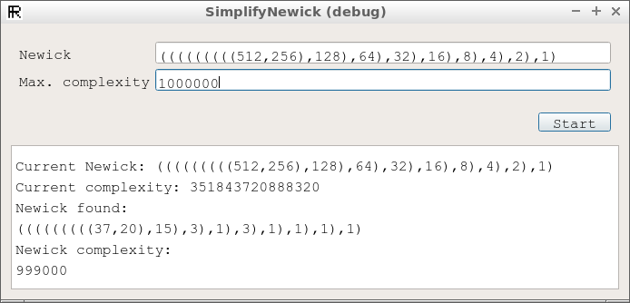

# SimplifyNewick

Simplify a phylogeny (in the
[Newick](https://github.com/richelbilderbeek/cpp/blob/master/content/CppNewick.md)
format) below a certain complexity.

SimplifyNewick is one of [Richèl Bilderbeek's
tools](https://richelbilderbeek.github.io/tools/).

## Links

- [Source code](https://github.com/richelbilderbeek/SimplifyNewick)
- [Richèl Bilderbeek's tools](https://richelbilderbeek.github.io/tools/)
